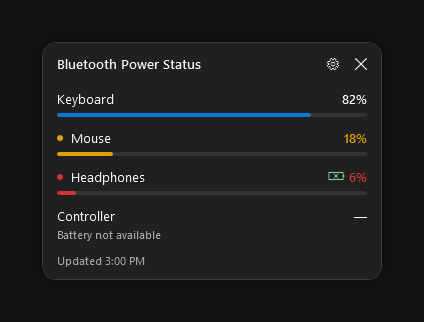
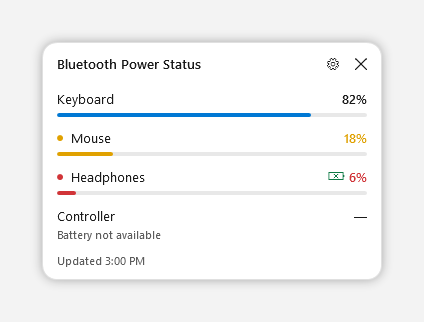

# BTWidget

BTWidget is a small Windows desktop widget that shows the battery level of devices that are connected right now. It exists so you can see that status without opening Windows Settings every time.

## What it does

- Lists Bluetooth devices Windows reports as connected.
- Shows the battery percentage when Windows or the device's standard battery service provides one.
- Shows a charging mark when the device reports that it is charging.
- Turns the percentage, bar, and tray icon amber at 20% or below, and red at 10% or below. The cutoff can be 10, 15, 20, or 25.
- Follows the current Windows app theme, including dark mode.
- Remembers where you left it.
- Stays on the desktop. Other windows cover it. **Keep above other windows** in the gear menu turns that overlay back on.
- Can start when you sign in. That option is off until you enable **Start with Windows**. It uses your personal startup list and does not need administrator rights.

Closing the window hides the widget. The tray icon opens it again, and **Exit** in the tray menu quits it.

## Screenshots

These pictures use example devices so the layout is visible on its own. A running copy lists the Bluetooth devices connected on that computer and follows that computer's light or dark app theme. Amber means 20% or below, red means 10% or below, and the green mark means the device reports that it is charging.





Battery and charging data come from the local device information Windows already maintains, plus a read of the standard Bluetooth battery service when a connected device publishes one. The widget does not pair devices, connect or disconnect them, or change radio settings. A headset that uses a USB receiver is not a Bluetooth device, so it is not listed.

Some devices never report a percentage or a charging state to Windows. Those rows stay in the list with an honest "not available" or no charging mark.

## Requirements

- Windows 10 version 1809 or later, or Windows 11. 32-bit, 64-bit, and Arm64 Windows are supported by the installer script.
- An x64 machine is the configuration this project was tried on.
- [.NET 8 SDK](https://dotnet.microsoft.com/download/dotnet/8.0) to build from this repository.
- [.NET 8 Desktop Runtime](https://dotnet.microsoft.com/download/dotnet/8.0) to run the installed program. The SDK includes the runtime.

The project targets `net8.0-windows10.0.17763.0` and rolls forward to a newer installed .NET runtime when one is present.

## Install and run

Clone the repository, then in PowerShell from the repository folder:

```powershell
powershell -ExecutionPolicy Bypass -File .\install.ps1
```

The script publishes a Release build for this PC's architecture into:

`%LOCALAPPDATA%\Programs\BTWidget\BTWidget.exe`

Start that program. Turn on **Start with Windows** from the installed program, so the startup entry points at that stable copy.

To run it from the source tree while you are changing the code:

```powershell
dotnet run
```

No extra NuGet packages are required. `dotnet restore` happens automatically on build.

## Technologies

- C# and .NET 8
- WPF for the window
- Windows Forms for the tray icon only
- Windows device configuration (`cfgmgr32`) and Bluetooth device enumeration for connection and battery data
- Windows Runtime Bluetooth GATT, read-only, for a live battery level and charging flag when the device publishes them
- A JSON settings file in `%LOCALAPPDATA%\BTWidget`
- The current-user `Run` registry key, and only after you opt in to startup

The program requests normal user rights. It does not include a network client.

## Reporting problems

If something is wrong, or a connected device is missing, open an issue on this repository. Include:

- Your Windows version
- The device name as it appears in Windows Settings
- Whether Windows Settings shows it as a connected Bluetooth device
- What the widget showed, including whether the battery percentage or charging mark was missing

Please do not include device addresses or other identifiers you would rather keep private.

Thank you for using BTWidget.
